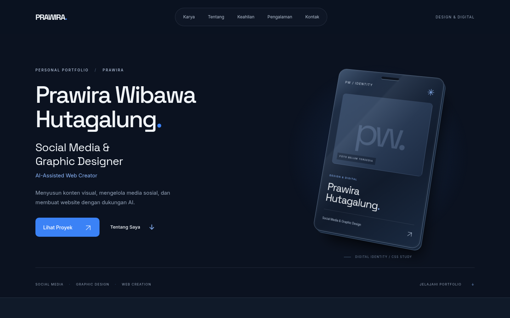
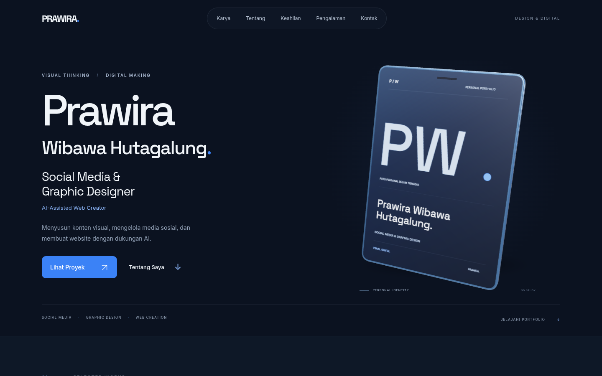
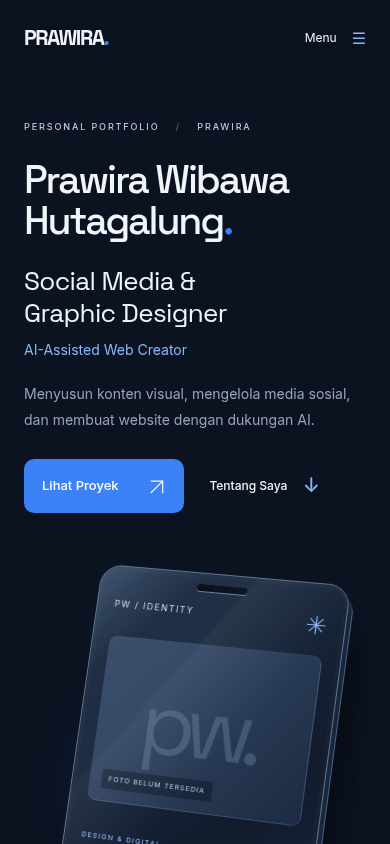
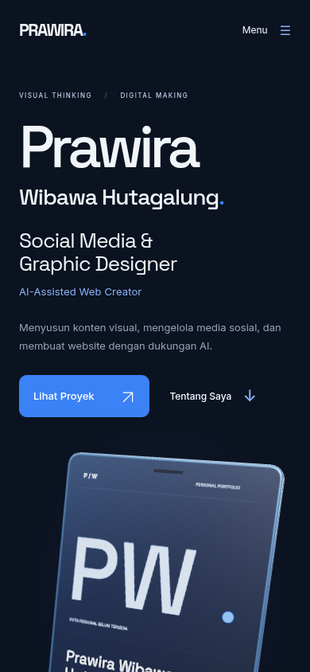
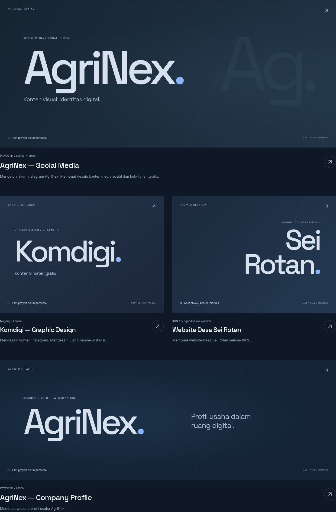
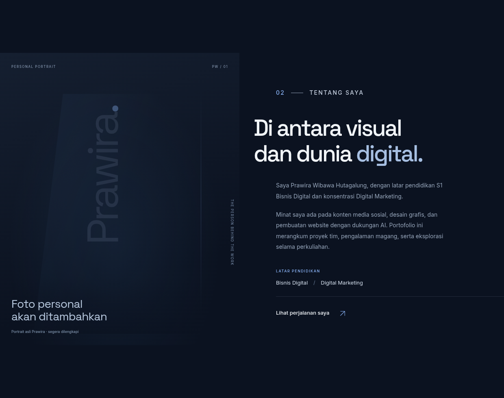

# Prawira — V4 Visual Review

Perbandingan screenshot aplikasi berjalan. Foto dan gambar proyek masih placeholder berlabel. Ini bukan deployment website.

## Desktop — 1440 × 900

Sebelum:

Sesudah (React Three Fiber / WebGL aktif):

## Mobile — 390 × 844

Sebelum:

Sesudah (WebGL aktif):

## Selected Works dan About

## Halaman lengkap

- [V3 desktop](before/1440-full.png) → [V4 desktop](after/1440-full.png)
- [V3 mobile](before/390-full.png) → [V4 mobile](after/390-full.png)
- [Fallback tanpa WebGL](after/1440-static-fallback.png)
- [Fallback tanpa JavaScript](after/390-no-js.png)

Periksa hierarki hero, ukuran kartu, ritme galeri, dan komposisi portrait. Foto dan karya asli akan mengubah karakter visual setelah tersedia.
