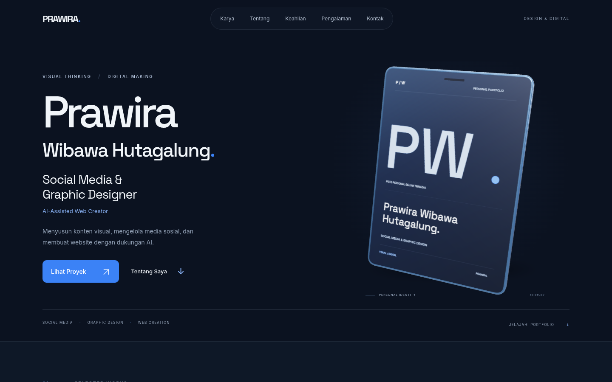
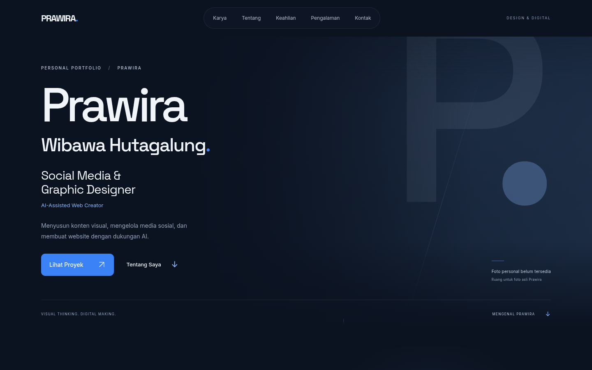
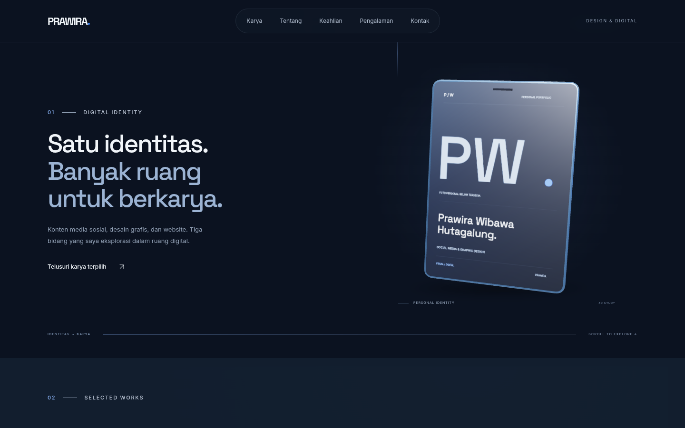
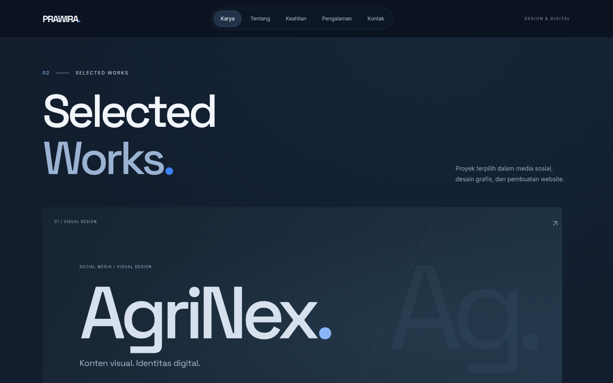
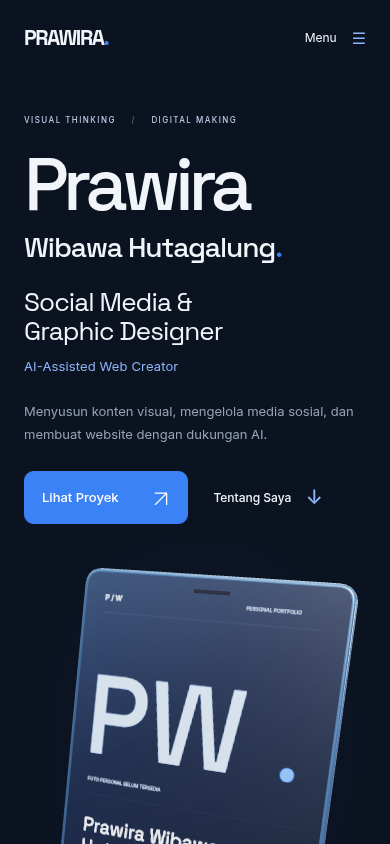
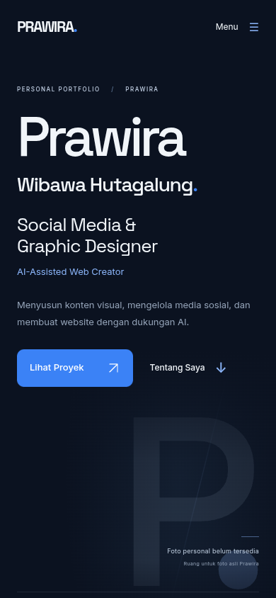
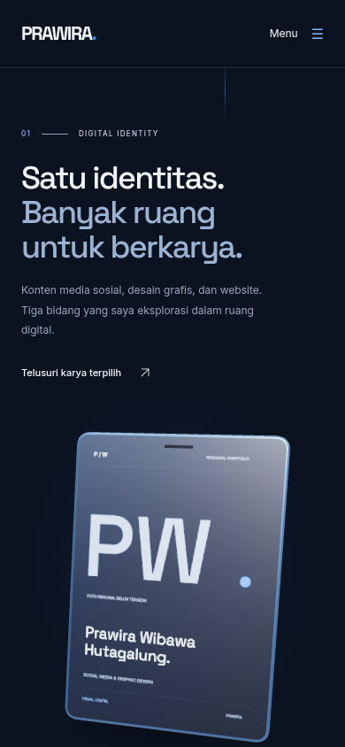
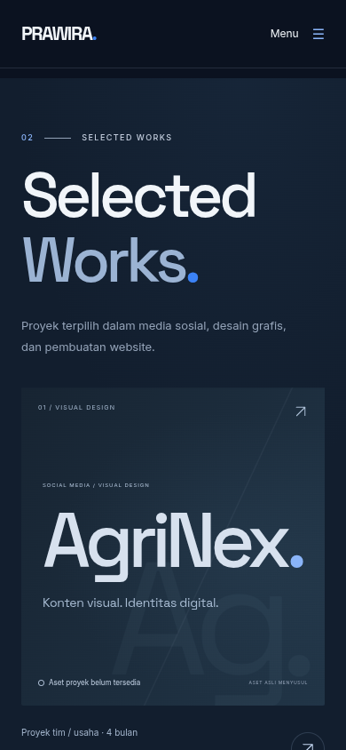

# Prawira — Motion V7 review

Actual build screenshots and recording. This iteration covers Hero → Digital Identity → Selected Works. Real personal photos and project assets are not supplied yet; placeholders remain explicitly labeled.

## Motion preview

[Download / open the actual browser recording (MP4)](v7-motion-preview.mp4)

The recording uses normal wheel scrolling and live WebGL, then reaches the existing About. There is no pinned scene or replacement scroller. GitHub may require **View raw / Download** to play the MP4.

## Before / after — desktop

Before (V4: card in hero):

After (V7: personal image stage):

The following separate scene:

Transition into works:

## Mobile

Before:

After:

## Validation

[Browser QA results](qa-results.json) · [Implementation notes](../../docs/09-MOTION-V7-IMPLEMENTATION.md)

Evaluate the pace between scenes and the hierarchy of name, roles, and CTA. The final hero photograph, facial crop, and contrast still need real user assets.
